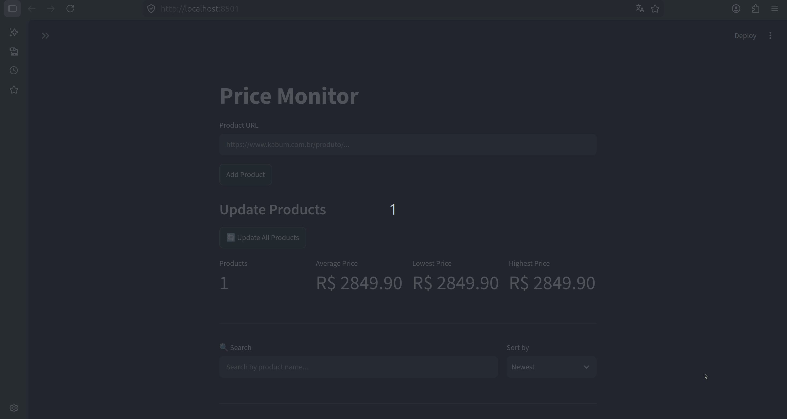

# Price Monitor

A local dashboard for tracking product prices from Brazilian online stores. Add a product URL, save its current price in SQLite, and review price changes over time.

## Demo

<p align="center">
  
</p>

## Features

- Add products from supported store URLs and prevent duplicate registrations.
- Update one product or all monitored products on demand.
- Save price history locally and inspect it in an interactive chart.
- Search, sort, and review summary metrics for monitored products.
- Use optional dashboard refresh to trigger periodic updates.
- Retry temporary store failures and report access blocks clearly.

## Supported stores

- KaBuM!
- TerabyteShop

Scrapers depend on each store's current page structure, which may change over time.

## Requirements

- Python 3.11 or newer
- Internet access to retrieve product pages

## Installation

Clone the repository:

```bash
git clone https://github.com/LuaKaiqueSilva/price-monitor.git
cd price-monitor
```

Create and activate a virtual environment:

```bash
python -m venv .venv
```

On Linux or macOS:

```bash
source .venv/bin/activate
```

On Windows PowerShell:

```powershell
.venv\Scripts\Activate.ps1
```

Install the project and its dependencies:

```bash
python -m pip install -e .
```

## Run the dashboard

```bash
streamlit run src/price_monitor/dashboard/app.py
```

Streamlit prints a local URL (usually <http://localhost:8501>). Paste a product URL into the dashboard to begin monitoring it. Product data is stored in `data/price_monitor.db` in the current working directory.

## Run the command-line flow

```bash
python -m price_monitor.main
```

## Development

Install optional formatting and linting tools with:

```bash
python -m pip install -e ".[dev]"
```

Run the offline test suite with:

```bash
python -m unittest discover -v
```

## Project structure

```text
src/price_monitor/
├── dashboard/       # Streamlit user interface
├── database/        # SQLite schema and repositories
├── models/          # Product and price history data models
├── scrapers/        # Store-specific page parsers
└── services/        # Product and price history workflows
```

## License

This project is licensed under the MIT License. See [LICENSE](LICENSE).
