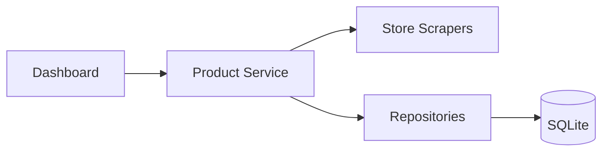

# Software Architecture

Price Monitor is a local Streamlit application organized into a small set of layers. The dashboard calls the service, the service coordinates a scraper and repositories, and repositories persist data in SQLite.

## Components

- `dashboard/`: Streamlit interface for adding, updating, searching, and removing products, and viewing price history.
- `demo.py`: in-memory sample products and histories for the dashboard preview.
- `services/`: product workflows, including choosing a scraper and recording price changes.
- `scrapers/`: shared request and parsing behavior plus one parser per supported store.
- `database/repositories/`: SQL operations for products and price history.
- `database/`: SQLite connection setup and schema initialization.
- `models/`: dataclasses shared across services and persistence.

## Add product flow

1. The dashboard passes a product URL to `ProductService`.
2. `ScraperFactory` selects a scraper based on the URL's hostname.
3. The scraper downloads and parses the product title and price.
4. The product repository saves the product, and the history repository saves its initial price.
5. The dashboard reloads the product list and history from SQLite.

## Update flow

The service loads a saved product, retrieves its current data through the matching scraper, and updates the product record. A history row is added only if the price changed. Deleting a product also deletes its history through SQLite's foreign-key cascade.

## Adding a store

Implement a `BaseScraper` subclass with a domain check, a `scrape` method, and a parser for the store's current product page. Add the scraper class to `SCRAPERS` in `scraper_factory.py` and cover the parser with offline HTML fixtures when automated tests are added.
